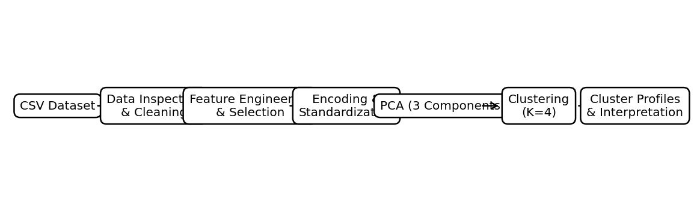
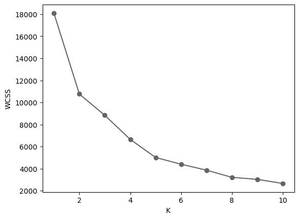
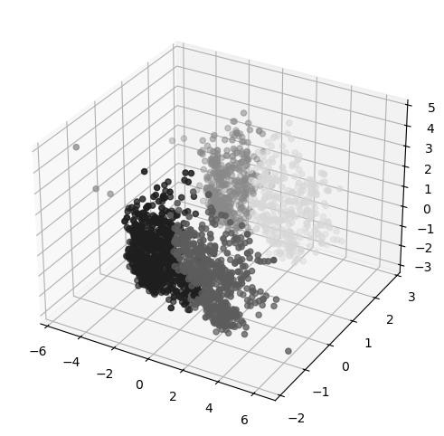

# Smart Customer Segmentation
Grouping customers by their purchasing behaviour using unsupervised machine learning (PCA, K-Means, Agglomerative Clustering).

## Problem
covering customer details, spending, purchase behaviour, website activity and campaign response.

SmartCart currently uses the same marketing and engagement approach for every customer, because it does not clearly understand how different customers behave. This causes:
- inefficient marketing
- missed chances to retain high-value customers
- late identification of customers who may leave


## 🎓 Academic Project

This project was submitted as a **Final Year Minor Degree Project**.

**Note:** This project was developed as a part of my learning from Apna College, and submitted as my college Minor Degree Project with additional improvements.

## Dataset
- 2,240 customers, 22 columns (demographics, spending on 6 product types, web/catalog/store purchases, web visits, recency, complaint, campaign response).
- Only `Income` had missing values (24), filled with the median.
- File: `dataset/smartcart_customers.csv`

## Method
1. Clean data (median imputation, removed 4 outliers: Age >= 90 or Income >= 600,000 -> 2,236 records)
2. Feature engineering: Age, Customer_Tenure_Days, Total_Spending, Total_Children, Living_With
3. One-hot encoding (Education, Living_With) -> 18 features, then StandardScaler
4. PCA to 3 components (44.95% variance)
5. Elbow method with KneeLocator -> K = 4
6. K-Means and Agglomerative Clustering (Ward), final profiles from Agglomerative



## Results
| Cluster | Profile | Mean income | Mean spending | Response |
|---|---|---|---|---|
| 0 | Lower spend, more website visits | ~39,681 | ~222 | 7.62% |
| 1 | High spend, buys on all channels | ~72,808 | ~1,237 | 16.67% |
| 2 | Lowest spend, most website visits | ~36,960 | ~166 | 14.19% |
| 3 | High spend, highest campaign response | ~70,723 | ~1,190 | 32.01% |

Cluster numbers are labels, not rankings.




## Project structure
```
notebook/   Jupyter notebook with the code
dataset/    customer data (CSV)
images/     charts used in this README
report/     full project report (PDF)
```

## How to run
```bash
git clone https://github.com/bhaktikatkar/smartcart-customer-segmentation.git
cd smartcart-customer-segmentation
pip install -r requirements.txt
jupyter notebook notebook/smartcart.ipynb
```

## Limitations
- PCA keeps only 44.95% of the variance.
- Silhouette scores and cluster sizes are not reported yet.
- `Response` was used as a clustering feature, so its cluster averages are descriptive only.
- Age uses a fixed 2026 reference year.

## Future work (Dashboard)
- [ ] Interactive dashboard (Streamlit / Power BI) showing segments, filters and charts
- [ ] Assign new customers to a segment
- [ ] Compare clustering on full features vs PCA

## Tech stack
Python, pandas, NumPy, matplotlib, seaborn, scikit-learn, kneed, Jupyter.
